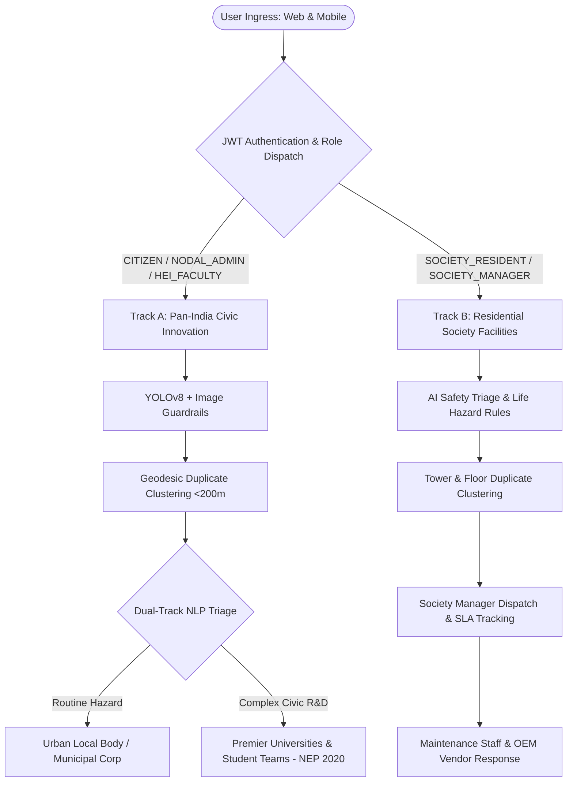

# 🇮🇳 Adhikar AI (अधिकार AI) — Comprehensive System Documentation
### National Citizen Innovation, Grievance Redressal & Residential Society Multi-Tenant Ecosystem
**Aligned with National Education Policy (NEP 2020) • Smart Cities Mission • MeitY**

---

## 📑 Table of Contents
1. [Executive Summary](#1-executive-summary)
2. [Dual Ecosystem Architecture](#2-dual-ecosystem-architecture)
3. [AI & Computer Vision Engine](#3-ai--computer-vision-engine)
4. [User Portals & Role-Based Navigation](#4-user-portals--role-based-navigation)
5. [Security, RBAC & Multi-Tenant Isolation](#5-security-rbac--multi-tenant-isolation)
6. [Database & Persistence Schema](#6-database--persistence-schema)
7. [Automated Verification Test Suites](#7-automated-verification-test-suites)
8. [Quick Start & Deployment Commands](#8-quick-start--deployment-commands)

---

## 1. Executive Summary

**Adhikar AI** is a state-of-the-art dual-track civic engagement, academic research, and residential facility management platform. It combines edge computer vision, NLP heuristics, multi-tier automated triaging, and multi-tenant security to solve both public municipal failures and private residential infrastructure problems.

### Core Pillars
- **Pan-India Civic Track**: Crowdsourcing municipal issues (potholes, garbage dumps, broken streetlights, fallen trees) with 1-tap live GPS geolocation and routing them either to Urban Local Bodies (ULBs) or premier academic institutions (IITs, NITs, Universities) under the **8-Stage NEP 2020 Student Capstone lifecycle**.
- **Residential Society Track (Phase 2)**: Multi-tenant operations management for housing societies and gated communities. Features automated AI safety escalation (electrical lifethreatening hazards, passenger elevator entrapment), tower-level duplicate clustering, vendor SLA tracking, and immutable audit logging.
- **Enterprise-Grade AI Guardrails**: Real-time screening preventing NSFW content, synthetic AI-generated images, and fraudulent claims from polluting municipal records.

---

## 2. Dual Ecosystem Architecture



### 1. Civic Innovation Track (Phase 1)
- **1-Tap Auto-GPS Geolocation**: Captures real-time device latitude, longitude, and reverses geocoding into State, District, and Ward/Block coordinates.
- **NEP 2020 8-Stage Lifecycle**:
  1. *Submitted* (GPS Geotagged & YOLOv8 verified)
  2. *Validated* (Domain categorization & Geodesic clustering)
  3. *Assigned to HEI* (Institution & student team allocation)
  4. *Research & Design* (Field engineering & feasibility study)
  5. *Prototyping* (Hardware/software prototype fabrication)
  6. *Testing & Validation* (Lab safety & certification)
  7. *Community Field Pilot* (On-ground installation)
  8. *Impact Verified* (Citizen sign-off & resolution closure)

### 2. Residential Society Platform (Phase 2)
- **Multi-Tenant Architecture**: Strict organization-level scoping (`organizationId`) isolating society data (e.g., Greenwood Heights vs. Palm Meadows Condos).
- **Automated AI Safety Escalation**:
  - *Exposed / Sparking Wires* $\rightarrow$ Automatically escalated to `CRITICAL` priority (`ELECTRICAL_LIFE_SAFETY`), with emergency standoff instructions.
  - *Elevator Trapped Passengers* $\rightarrow$ Automatically escalated to `CRITICAL` (`PASSENGER_ENTRAPMENT`) with direct OEM response dispatch.
- **Tower Duplicate Clustering**: Corroborating reports within the same tower and category are merged into a single cluster master while preserving individual unit details and corroborator tallies.
- **Manager Console**: KPI cards (Total, Critical, Open, In Progress, Resolved, MTTR), SLA monitoring, technician dispatch, and tamper-evident audit history.

---

## 3. AI & Computer Vision Engine

The AI Engine runs on Python (Flask/FastAPI) on port `5000` (`ai-engine/app.py`).

| Capability | Module | Description |
| :--- | :--- | :--- |
| **4-Class Object Detection** | `ultralytics` YOLOv8 | Detects `Pothole`, `Garbage Dump`, `Broken Streetlight`, `Fallen Tree` with bounding boxes and confidence scores. |
| **Synthetic AI Guardrail** | `image_guardrails.py` | Detects AI-generated/manipulated images using frequency domain analysis (FFT high-frequency variance) and metadata analysis. |
| **NSFW Content Screening** | `image_guardrails.py` | Multi-threshold skin-tone and color space inspection ensuring no explicit or abusive content enters civic queues. |
| **Priority Assignment** | Heuristic Severity Scorer | Server-assigned priority (`LOW`, `MODERATE`, `HIGH`, `CRITICAL`) based on visual confidence, domain risk, and traffic impact. |
| **Society Safety Triage** | `/v1/society/detect` | Evaluates residential maintenance photos, suggests descriptions, and injects emergency guidance warnings. |

---

## 4. User Portals & Role-Based Navigation

The frontend is a single-page React 19 application built with Vite and Tailwind CSS. The top navbar provides responsive, role-based navigation without clutter.

| Portal | URL Path | Target Persona | Key Capabilities |
| :--- | :--- | :--- | :--- |
| **Citizen Dashboard** | `/dashboard` | Citizen / Submitter | Submit civic challenges, view personal complaints, explore Pan-India GIS map, verify resolved pilots. |
| **New Challenge Form** | `/new-challenge` | Citizen | Auto-GPS, live camera capture, instant AI vision feedback, duplicate preview. |
| **Nodal Admin Console** | `/admin` | Municipal / District Officer | Real-time complaint triage, priority override with justification, cluster unlinking, university allocation. |
| **University Hub** | `/university` | HEI Faculty / Students | Capstone project workspace, multidisciplinary student team builder, deliverable milestone uploads. |
| **Society Resident Portal** | `/society/resident` | Society Resident | Raise maintenance tickets, view active requests, see assigned technician contacts, track resolution audit trail. |
| **Society Manager Console**| `/society/manager` | Facility Operations Manager | Multi-tower filter, real-time MTTR & SLA cards, technician assignment, status transition, ticket decoupling. |
| **Authentication** | `/login`, `/register` | All Roles | Unified login with quick role switching, mock development mode, and Spring Boot JWT authentication. |

---

## 5. Security, RBAC & Multi-Tenant Isolation

Security is enforced at both the API Gateway and Controller levels using **Spring Security 6** and **JWT (JSON Web Tokens)**.

### Access Control Matrix
| Endpoint Pattern | Permitted Roles | Notes |
| :--- | :--- | :--- |
| `POST /api/auth/**` | Public (`permitAll`) | Register and login endpoints. |
| `GET /api/society/organizations` | Public (`permitAll`) | Public society directory for registration. |
| `GET /api/challenges/**` | Public / Authenticated | Anyone can view public civic challenges. |
| `POST /api/challenges` | `CITIZEN`, `ADMIN` | Citizens create civic reports. |
| `PUT /api/challenges/{id}/override-priority` | `NODAL_ADMIN`, `ADMIN` | **Strictly forbidden (403)** to Citizen and Resident roles. |
| `POST /api/challenges/{id}/separate-cluster` | `NODAL_ADMIN`, `ADMIN` | **Strictly forbidden (403)** to Citizen and Resident roles. |
| `GET /api/society/issues/**` | `SOCIETY_RESIDENT`, `SOCIETY_MANAGER`, `ADMIN` | Scoped by `organizationId`. Cross-tenant requests rejected with **403 Forbidden**. |
| `PUT /api/society/issues/{id}/status` | `SOCIETY_MANAGER`, `ADMIN` | **Strictly forbidden (403)** to Citizen and Resident roles. |
| `POST /api/society/issues/{id}/separate-cluster`| `SOCIETY_MANAGER`, `ADMIN` | **Strictly forbidden (403)** to Citizen and Resident roles. |
| `GET /api/society/metrics` | `SOCIETY_MANAGER`, `ADMIN` | Aggregate metrics scoped to user's organization. |

---

## 6. Database & Persistence Schema

Adhikar AI utilizes a relational PostgreSQL database schema (`sih_project_2026`) managed via Hibernate ORM:

### Primary Entities
1. **`users`**:
   - `id`, `name`, `email`, `password_hash`, `role`, `organization_id`, `district`, `state`.
2. **`challenges`** (Civic Issues):
   - `id`, `title`, `description`, `domain`, `priority`, `status`, `stage` (1–8), `latitude`, `longitude`, `is_cluster_master`, `cluster_id`, `duplicate_count`, `priority_override_by`.
3. **`organizations`** (Societies & Municipal Units):
   - `id`, `name`, `code`, `city`, `type` (`RESIDENTIAL_SOCIETY`, `MUNICIPAL_ULB`, `ACADEMIC_HEI`).
4. **`society_issues`** (Residential Tickets):
   - `id`, `organization_id`, `title`, `description`, `category`, `building_tower`, `unit_floor`, `resident_name`, `resident_phone`, `priority`, `status`, `is_cluster_master`, `cluster_id`, `duplicate_count`, `assigned_staff_name`, `assigned_staff_phone`, `safety_flags`, `emergency_guidance`, `created_at`, `resolved_at`.
5. **`society_issue_audits`** (Immutable Audit Trail):
   - `id`, `issue_id`, `action`, `previous_status`, `new_status`, `notes`, `actor_email`, `actor_role`, `created_at`.
6. **`maintenance_staff`**:
   - `id`, `organization_id`, `name`, `role`, `phone`, `active`.

---

## 7. Automated Verification Test Suites

The project features automated regression and integration test suites that run against live daemons.

### 1. Phase 1 Verification Suite (`test_phase1_verification.py`)
- **Test 1**: AI Engine Assessment (`/api/v1/detect`) returns valid schema and verification flags.
- **Test 2**: Civic Complaint Submission assigns server-side priority and initializes cluster master.
- **Test 3**: Complaint View by ID verifies persisted submitter data and priority.
- **Test 4**: Spatial duplicate clustering:
  - Different domain nearby $\rightarrow$ Not merged.
  - Same domain $>200\text{m}$ away $\rightarrow$ Not merged.
  - Same domain $<200\text{m}$ (corroborating) $\rightarrow$ Merged into cluster master; duplicate counter incremented.
- **Test 5**: Security & Authorization:
  - Unauthenticated requests rejected with `401/403`.
  - Citizen attempts to override priority or unlink clusters rejected with `403 Forbidden`.
  - Authorized Nodal Admin successfully overrides priority and detaches cluster.

### 2. Phase 2 Verification Suite (`test_phase2_verification.py`)
- **Test 1**: Register & authenticate all 4 roles (`CITIZEN`, `NODAL_ADMIN`, `SOCIETY_RESIDENT`, `SOCIETY_MANAGER`).
- **Test 2**: AI Safety Triage escalates exposed wiring and lift entrapment to `CRITICAL` with emergency instructions.
- **Test 3**: Tower-level duplicate clustering links neighbor elevator reports and updates cluster count.
- **Test 4**: Multi-Tenant data isolation:
  - Resident from Org 3 accessing Org 2 ticket rejected with `403 Forbidden`.
  - Citizen attempting manager status update rejected with `403 Forbidden`.
  - Society resident calling civic nodal override rejected with `403 Forbidden`.
- **Test 5**: Society manager workflow:
  - Assigns technician and updates status to `IN_PROGRESS` $\rightarrow$ `RESOLVED`.
  - Generates immutable audit records.
  - Successfully unlinks secondary reports into independent tickets.
  - Returns calculated MTTR and resolution metrics.

---

## 8. Quick Start & Deployment Commands

### Prerequisites
- Java 17+ (JDK)
- Python 3.10+
- Node.js 18+ & npm
- PostgreSQL 14+ running on port `5432` with database `sih_project_2026`

### Running the Services

1. **AI Vision Engine** (Port 5000):
   ```bash
   cd ai-engine
   python app.py
   ```

2. **Spring Boot Backend** (Port 8085):
   ```bash
   cd backend
   ./gradlew.bat bootRun
   ```

3. **React Vite Frontend** (Port 5173):
   ```bash
   cd frontend
   npm install
   npm run dev -- --host 0.0.0.0
   ```

4. **Running Automated Tests**:
   ```bash
   # Run Phase 1 verification
   python test_phase1_verification.py

   # Run Phase 2 verification
   python test_phase2_verification.py
   ```

5. **Building Frontend for Production**:
   ```bash
   cd frontend
   npm run build
   ```

---
*Generated for Adhikar AI (अधिकार AI) • National Innovation & Grievance Redressal Ecosystem*
